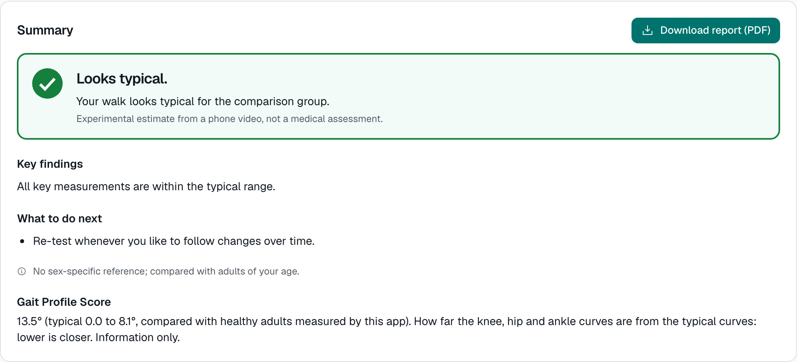
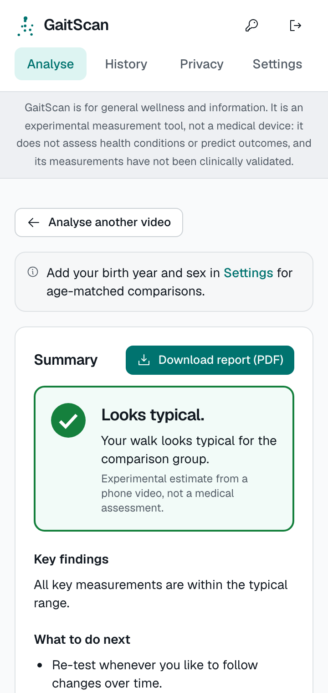
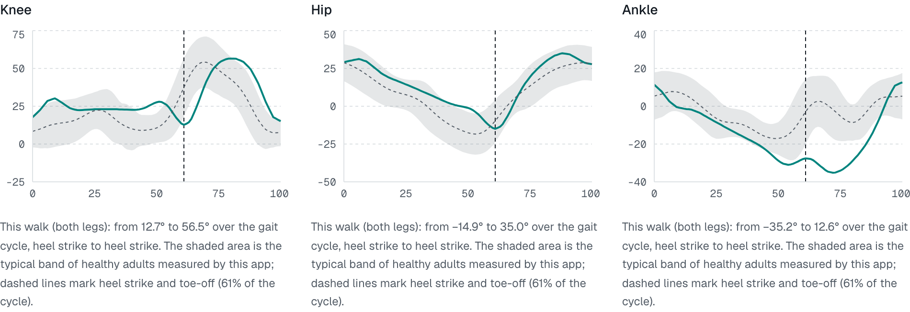
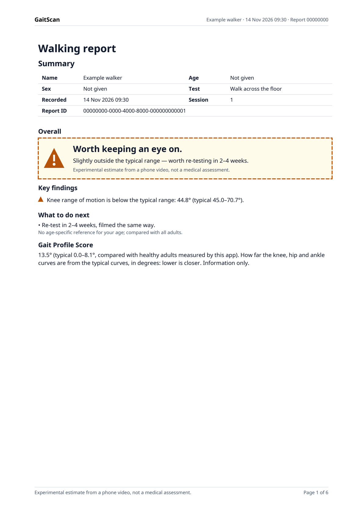

# GaitScan — Backend

[](https://github.com/KanveerMadan/GaitScan/actions/workflows/ci.yml)


Measures how you walk from a phone video: cadence and step time with error ranges from a published
accuracy check, and a gait profile (timing, knee, hip and ankle movement) compared with healthy adults,
with an overall summary in general-wellness wording and a PDF report in English and Hindi. FastAPI +
MediaPipe Pose. The web app is in [gaitscan-frontend](https://github.com/KanveerMadan/gaitscan-frontend).

**Live app:** https://gaitscan-frontend-mnt9.vercel.app · **Example result, no account:**
https://gaitscan-frontend-mnt9.vercel.app/demo

> **Not a medical device.** GaitScan is for general wellness and information. It is an experimental
> measurement tool: it does not assess health conditions or predict outcomes, and its measurements have
> not been clinically validated.

## Screenshots
From the frontend's end-to-end mock data, which is this pipeline's output for the simulated walker in
`tests/synthetic.py` (no real user data), at 2×. The PDF page comes from `tools/readme_pdf_page.py`.

| Result summary | Phone (360 px) |
|---|---|
|  |  |





## What it measures
Every value is from the steady part of each walk across the frame; turns, speeding up and slowing down
are left out. Values are for both legs together (see "What isn't shown").

| Measurement | Status | Error range |
|---|---|---|
| Cadence (steps/min) | Validated on LJMU | ±4.5 steps/min (95% of clips within) |
| Step time (s) | Validated on LJMU | ±0.024 s (95% of clips within) |
| Step-time variability (%) | From the validated step times; the variability itself isn't validated | — |
| Stance, swing, double support (% of the stride) | Heel strikes validated on LJMU (17 ms mean error on held-out clips); toe-off not validated (no reference), values plausible | — |
| Knee, hip, ankle: key events and range of motion, curves over the gait cycle | **Experimental estimate** (no angle reference in LJMU) | About ±5.6° knee, ±4.0° hip, ±7.4° ankle (a similar video method against motion capture: Stenum et al. 2021). Hip also notes that its thigh range read 9° above LJMU's thigh sensor on average |
| Trunk lean | Information, not validated | — |
| Arm swing (upper arm, shoulder → elbow) | Information only, never changes the summary. Checked against LJMU's upper-arm sensor (D6): bias +2.7°, r = 0.60 ([arm swing](docs/validation/arm-swing.md)) | ±7.0° (mean difference from the sensor) |
| Gait Profile Score (Baker et al. 2009) | Information: the knee, hip and ankle curves against healthy LJMU walkers' | Typical 0–8.1° (95% of healthy LJMU walkers) |
| Step length (m), walking speed (m/s) | **Not yet validated**; only with a floor calibration | — |
| Treadmill test: cadence, step time, step length from the entered belt speed | **Not yet validated** (no treadmill reference clips) | — |

The "not yet validated" labels for step length, speed and the treadmill are permanent: no more video
will be collected (owner decision 2026-11-12). How the numbers were checked, and where they fail:
[model card](docs/model-card.md), [docs/validation/](docs/validation/).

**Gait profile and verdicts (Phase 11, pipeline 3.0.0).**
- **Label-free legs.** Knee, hip and ankle measures don't use MediaPipe's left/right labels: each leg's
  role in a stride comes from foot motion and footprints ([kinematics](docs/validation/kinematics.md)).
- **References.**
  - Cadence is compared with Mobbs et al. 2025 (*Sensors* 25(2):581, CC BY 4.0) by sex and 10-year age
    group.
  - Every other key measure is compared with healthy adults of the LJMU dataset measured by this app
    (`make references`), by age group and sex where at least 10 people are in a group.
  - The result says when it falls back: "No age-specific reference for your age; compared with all
    adults."
- **Verdicts** ([docs/verdicts.md](docs/verdicts.md)):
  - Typical within ±2.5 SD and outside beyond ±3.5 SD, widened from ±2 / ±3 SD to pass the release
    gate: 13.8% "keep an eye on it" and 0% "outside" among healthy LJMU walkers.
  - Key measures: cadence, step-time variability, peak knee bend in swing, knee and hip range of
    motion, and hip extension.
  - The overall summary is "Looks typical", "Worth keeping an eye on", or "Outside the typical range. If
    you have concerns about your walking, a physiotherapist can assess it properly."
  - It never names a condition, and it isn't given when there are too few steps or too little steady
    walking, or the legs weren't seen clearly.
  - It's worked out each time a result is read, from the person's current age and sex; shared links
    compare with all adults.
- **Trends:** `GET /me/trends` gives each session's key numbers and verdict, for the progress view.
- **PDF report** (`GET /report/{id}?lang=en|hi`): multi-page (6 pages, 7 with earlier sessions).
  - Pages: summary, timing and rhythm, joint movement, progress, and recording quality and method.
  - Vector charts, levels readable in black and white, and Noto fonts with Devanagari shaping for
    Hindi.

**What isn't shown, and why.**
- **Left/right values and symmetry.** In a side view, MediaPipe's leg labels can't be checked: LJMU's
  walkers wear the same clothes on both legs, and the frames are blurred. An annotation attempt couldn't
  tell the front leg reliably ([leg identity](docs/validation/leg-identity.md)).
- **Pelvis oscillation.** It's computed and stored but read about twice the published values, so it
  isn't shown.
- **Never measured, by design:** risk scores, activity labels, frontal-plane angles, uncalibrated
  distances, and exercise advice.

Before measuring, the **recording checks** turn down videos that can't be measured, with a reason the
user can act on: too short, a low frame rate, nobody in view, a rotated picture, not side-on, too few
or irregular steps, or the legs not followed. A second person, or heels out of view, for a step or more
removes only that stretch.

## How to film
Side-on, landscape, phone still at waist height 3–4 m from the walking line, 30 fps; walk across the
frame and back for 10–20 s. Details and the reasons behind them:
[docs/capture-protocol.md](docs/capture-protocol.md).

## Run it locally
Python 3.11 and [uv](https://docs.astral.sh/uv/).

```bash
uv sync                                  # .venv from uv.lock
uv run python gaitcore/model.py fetch    # pinned pose model (SHA-256 checked) -> gaitcore/models/
cp .env.example .env                     # ENV=dev works as is
uv run alembic upgrade head              # SQLite in dev
uv run uvicorn app.main:app --reload --env-file .env
```

API docs: http://localhost:8000/docs (only with `ENV=dev`).

**macOS (Apple silicon):** MediaPipe 1.0.1 aborts during pose extraction ("Service is unavailable").
Anything that decodes video runs in the Docker image (Linux), which is also what production runs:

```bash
docker build -t gaitscan-api .
docker run -p 8000:8000 --env-file .env gaitscan-api   # migrations, then uvicorn
```

Tests use synthetic landmarks and run anywhere.

## Checks
```bash
ENV=dev uv run pytest                               # 458 tests (SQLite)
TEST_POSTGRES_URL=postgresql://... uv run pytest     # + migrations on Postgres (CI does this)
uv run ruff check . && uv run ruff format --check . && uv run mypy
uv run pre-commit install                            # the same on every commit
make check                                           # all of the above in one go
```

What the suites rely on:
- **Synthetic ground truth.** `tests/synthetic.py` simulates a walker whose heel strikes, cadence,
  step length and joint positions are known exactly.
- **Golden file.** `tests/golden/v2_pipeline.json` pins the whole output, gait profile included. After an intended change,
  regenerate it with `ENV=dev uv run python tests/test_golden.py --regenerate` and say so in the
  commit.

## Accuracy check (`make evaluate`)
Uses the LJMU gait dataset (Topham et al. 2023, *Scientific Data*, CC BY 4.0). Videos and landmarks
stay outside git.

```bash
make fetch-ljmu                       # side-view videos -> data/ljmu/videos
make evaluate                         # -> evaluation/results/ljmu_clips.csv, ljmu_summary.json
```

`tests/test_accuracy.py` fails if the error ranges the API shows (`gaitcore/accuracy.py`) drift from
the latest summary. `evaluation/degrade.py` runs the degradation curves, and
`evaluation/reliability.py` runs the reliability-model evaluation
([write-up](docs/reliability-engine.md)).

## Configuration and deployment
- **Configuration.** Every variable is described in [.env.example](.env.example). Outside `ENV=dev`
  the app refuses to start without a strong `JWT_SECRET`, `CORS_ORIGINS` and `DATABASE_URL`.
- **Deployment.** Render, from [render.yaml](render.yaml): a Docker web service with one uvicorn
  worker and the health check `/healthz`. The container runs `alembic upgrade head` before
  starting.

## API
| Method | Path | Who |
|---|---|---|
| POST | `/auth/register`, `/auth/login` | anyone (rate-limited) |
| POST | `/auth/google` (Google ID token) | anyone; answers 503 until `GOOGLE_CLIENT_ID` is set |
| GET · POST | `/auth/me` · `/auth/change-password` | signed in |
| POST | `/auth/recover` (email + recovery code + new password) | anyone (rate-limited) |
| POST | `/auth/recovery-codes` (a new set; needs the password) | signed in |
| POST | `/auth/password-reset`, `/auth/password-reset/confirm`, `/auth/verify-email`, `/auth/verify-email/request` | unused: answer 503 while no email is sent (`MAIL_BACKEND=none`) |
| GET · POST · DELETE | `/consent` | signed in |
| GET · PATCH | `/me/settings` (reminders, units, language, theme, cadence goal) | signed in |
| GET · POST · PATCH · DELETE | `/profiles`, `/profiles/{id}` (other adults on the account) | owner |
| POST · GET | `/analyses` (202) · `/analyses/{job_id}` (poll); `test=treadmill` needs `belt_speed_kmh` | signed in, with consent |
| POST | `/analyze` (synchronous; for scripts, the app uses `/analyses`) | signed in, with consent |
| GET · PATCH · DELETE | `/sessions`, `/sessions/{id}` (PATCH: notes, tags; `?profile_id=`) | owner; a linked clinician can read the holder's own |
| GET · POST | `/sessions/{id}/comments` | owner or linked clinician |
| GET | `/report/{id}?lang=en\|hi` (PDF; default: the reader's language setting) | owner or linked clinician |
| GET | `/me/trends?profile_id=` (per-session key numbers and verdict) | signed in |
| GET | `/references` (typical joint curves and GPS band; public, cacheable) | anyone |
| GET · POST · DELETE | `/sessions/{id}/shares`, `/shares/{share_id}` | owner |
| POST | `/shared` (open a share link) | anyone with the token (rate-limited) |
| GET · DELETE | `/me/export`, `/me` | signed in |
| POST · GET | `/clinician/invite`, `/clinician/patients`, `/clinician/patients/{id}/sessions` | clinician |
| GET · POST | `/clinician/inbox`, `/clinician/inbox/seen` | clinician |
| POST | `/patient/join` | patient (rate-limited) |
| GET | `/healthz` | anyone |

The OpenAPI contract is committed at `contracts/openapi.json`. The frontend generates its client from
it, and CI in both repos fails on drift.

## Project layout
| Path | What it holds |
|---|---|
| `gaitcore/` | The analysis core: landmarks → quality checks → steps → measurements → gait profile and verdict (`kinematics.py`, `profile.py`, `verdict.py`, `norms/`). No web or database code (ADR-001) |
| `app/` | FastAPI app: routes (`app/api`), models and database (`app/db`), the verdict's words (`app/core/verdict_copy.py`), PDF reports with bundled Noto fonts, configuration |
| `alembic/` | Database migrations (SQLite in dev, Postgres in production) |
| `evaluation/` | The LJMU accuracy check, degradation curves and reliability evaluation, with committed results |
| `tests/` | Pytest suites, the synthetic walker (`tests/synthetic.py`) and the golden file |
| `contracts/` | The OpenAPI contract the frontend client is generated from |
| `loadtest/`, `tools/` | Locust load test; scripts that export the landing-page walker and render the README's PDF page |
| `docs/` | [Documentation index](docs/README.md) |
| `_audit/` | The audit, plans, ADRs and phase evidence ([what's in it](_audit/README.md)) |

## License
[MIT](LICENSE). The licence covers this code only. It doesn't make GaitScan a medical device or
its measurements clinically validated: see the statement at the top.

Third-party material keeps its own terms: the LJMU reference data used by `make evaluate` is Topham
et al. 2023 (CC BY 4.0), the MediaPipe pose model is Apache 2.0, and the cadence reference shown in
the app is Mobbs et al. 2025 (CC BY 4.0). The PDF fonts are Noto Sans and Noto Sans Devanagari (SIL Open
Font License 1.1, `app/assets/fonts/`).

## More
- [Documentation index](docs/README.md)
- [Architecture](docs/architecture.md)
- [Model card](docs/model-card.md)
- [Security and threat model](SECURITY.md)
- [Audit findings](docs/findings.md)
- [Changelog](CHANGELOG.md)
- [Case study](docs/case-study.md)
- [Contributing](CONTRIBUTING.md) · [Code of conduct](CODE_OF_CONDUCT.md)
