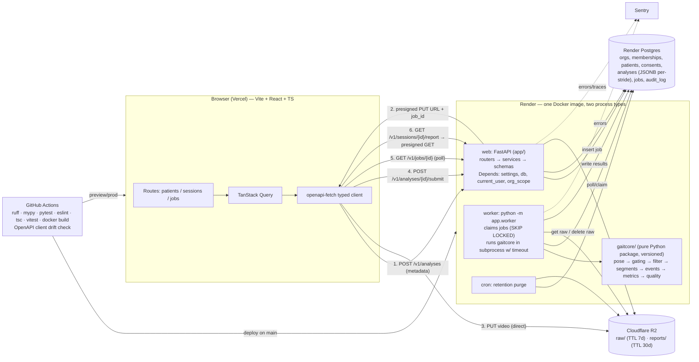

# GaitScan — Incremental Rebuild Plan

Companion to [`GAITSCAN_AUDIT.md`](GAITSCAN_AUDIT.md). Finding IDs (F01…) refer to the audit's findings table.
ADRs: [001 monolith + core package](adr/001-modular-monolith-with-core-package.md) · [002 job queue](adr/002-postgres-backed-job-queue.md) · [003 storage](adr/003-object-storage-with-ttl.md) · [004 tenancy/auth](adr/004-tenancy-and-auth.md) · [005 no risk score](adr/005-replace-risk-score-with-measurement-summary.md) · [006 pipeline v2](adr/006-measurement-pipeline-v2.md) · [007 privacy](adr/007-privacy-consent-retention.md) · [008 frontend](adr/008-frontend-architecture.md)

Ground rule for every phase: **main is always deployable.** Each task is one PR, merged only when CI is green (from Phase 1 on).

---

## D1. Module verdicts

| Module | Verdict | Reason (evidence) | Effort | Depends on |
|---|---|---|---|---|
| `src/api/main.py` | **REFACTOR** | God-file: orchestration, persistence, serialisation, PDF regen (`main.py:52-283`). Split into `app/api/{analyses,sessions,reports}.py` + `app/services/analysis_service.py` + Pydantic response schemas. Hotfixes first: auth on `/sessions/{id}` and `/report/{id}` (F02), generic 500s (F09), CORS allow-list (F08), `finally:` cleanup (F06) | M | Phase 0 hotfixes, then ADR-001 |
| `src/api/auth_router.py` | **REPLACE** | Client-chosen role (F03), enumeration (F12), no password policy, duplicate `require_clinician` (`L70-76`). Replaced by org-scoped auth (ADR-004) | M | ADR-004 |
| `src/api/clinician_router.py` | **REPLACE** | Patient-as-account model doesn't fit clinics. `/debug/links` leaks all links (F03). `random` invite codes (F10). **Keep the ownership-check pattern** at `L156-162` | M | ADR-004. Delete `/debug/links` in Phase 0 |
| `src/core/auth.py` | **REPLACE** | Committed secret (F01), password `print` (F04), 365-day tokens (F08), python-jose CVEs (F11). → PyJWT, env secret, short access + refresh cookie | S | Phase 0 (secret/print), ADR-004 |
| `src/core/database.py` | **REFACTOR** | Silent SQLite fallback, `create_all`, `declarative_base` legacy import (`L2, 6, 26-29`). → pydantic-settings, SQLAlchemy 2.0 `DeclarativeBase`, Alembic | S | Phase 1 |
| `src/core/models.py` | **REPLACE** | Stores 10 summary numbers only; no mode, pipeline version, per-stride data, org (F15). New schema per ADR-003/004 | M | ADR-003/004 |
| `src/models/user.py`, `src/models/clinician_patient.py` | **REPLACE** | Free-text role, no org (Part C) | M | ADR-004 |
| `src/core/extract_landmarks.py` | **REFACTOR** | Right idea, wrong details: legacy API, full-res frames, visibility ignored, dropped frames silent, `print` logging (F26, F32). → Tasks `PoseLandmarker` VIDEO mode, 640 px downscale, container timestamps, NaN rows for missed frames, model hash | M | ADR-006 |
| `src/core/calculate_angles.py` | **REFACTOR** | Math core is correct (tests pass) but in normalised coords (F25). Degenerate → 90° (F42), dead `shoulder_tilt` (F33), row-wise `df.apply`. → pixel space, NaN on degenerate, signed flexion, vectorised NumPy | S | ADR-006 |
| `src/core/activity_classifier.py` | **DELETE** | 4 unjustified thresholds; "confidence" isn't one; healthy walk → Unknown (F30). The clinician states the task. Revisit only with labelled data | S | ADR-005 |
| `src/core/risk_scoring.py` | **REPLACE** | Invented composite, insensitive, max 80, diagnostic copy (F23, F24, F27, F28, F36). → `gaitcore/metrics.py` (per-stride spatiotemporal + kinematics) + `reference_ranges.yaml` with citations + `quality.py` gate | L | ADR-005/006 |
| `src/core/exercise_prescription.py` | **DELETE** (from pipeline) | LLM health advice to patients, "RAG" overclaim, sends data to Groq, can crash the PDF (F06, F20, F37). If clinics want it later: a clinician-curated exercise library as data, attached manually | S | ADR-007 |
| `src/core/report_generator.py` | **REFACTOR** | Layout helpers are reusable. Content is wrong: thresholds table contradicts scoring (F35), unescaped markup (F20), no patient identifiers (F40), regenerates wrong mode (F15). → driven by persisted `AnalysisResult`, escaped text, measurement-summary content | M | ADR-005, Phase 3 |
| `src/utils/visualise.py` | **REPLACE** | pyplot global state, no backend set (F19), plots with clipping y-limits. → ReportLab native charts (`reportlab.graphics`) or matplotlib OO API with Agg; web charts in Recharts | S | Phase 6 |
| `main.py` (root, empty), `tests/test_angles.py` (empty), `notebooks/` (empty), `runtime.txt` | **DELETE** | Empty or ineffective (§4 items 12, 14) | S | — |
| `gaitscan.db` (tracked) | **DELETE** from git | `git rm --cached`; still tracked despite commit `5f34703` | S | — |
| `requirements.txt` | **REPLACE** | Frozen dev venv + duplicates + unpinned + dead deps + 3 OpenCV wheels (F16). → `pyproject.toml` + `uv.lock` | S | Phase 1 |
| `.gitignore` | **REFACTOR** | Typo `*.gifoutputs/`; add `_audit/.venv`, `*.db` | S | — |
| `README.md` | **REFACTOR** | Overclaims (§6 README table). Rewrite after Phase 2 with a validation table after Phase 5 | S | Phases 2, 5 |
| Frontend `App.js` (1,102 LOC) | **REFACTOR** | Keep the visual language; split into routes/components; remove inline threshold logic (F35, F39) | M | ADR-008 |
| Frontend `AuthProvider` / localStorage auth | **REPLACE** | Plaintext password stored (F05); token logged (F08); effect-ordering bug | S | Phase 0 (delete creds), ADR-004/008 |
| Frontend CRA (`react-scripts`) | **REPLACE** | Deprecated; most of the 48 npm advisories | S | Phase 1 |
| Frontend `axios` | **REPLACE** | 28 advisories at 1.14.0; the untyped calls are the real problem → `openapi-fetch` typed client | S | ADR-008 |
| Frontend Recharts | **KEEP** | Appropriate for per-stride curves and trends | — | — |
| Frontend `App.test.js` | **REPLACE** | Failing CRA boilerplate (F38) | S | Phase 1 |
| bcrypt password hashing | **KEEP** (concept) | Correct choice; call `bcrypt` directly (drop passlib) | — | ADR-004 |

---

## D2. Target architecture

| Concern | Choice | Why it fits now |
|---|---|---|
| API layer | FastAPI with `app/api` routers (versioned `/v1`), `app/services` use cases, `app/schemas` Pydantic models, `Depends` for settings, DB session, current user and org scope | You already know FastAPI; typed schemas give free OpenAPI → typed frontend client |
| Analysis core | `gaitcore/` package with no web imports, semver + model hash, CLI entry point for validation | Testable in isolation and runnable by the eval harness and the worker; the most interview-worthy part |
| Async jobs | Postgres jobs table + one Render Background Worker (ADR-002) | No Redis to pay for or secure; transactional; ~80 lines. Upgrade path to Arq when needed. Celery is overkill |
| Storage | Cloudflare R2 with presigned PUT/GET and lifecycle TTL (ADR-003) | Zero egress, free tier, S3 API; removes video bytes from the API and gives verifiable deletion |
| Database | Render Postgres + SQLAlchemy 2.0 + Alembic | Already in use; migrations make schema changes safe |
| Auth & tenancy | Org → Membership(owner/practitioner) → Patient records; PyJWT short-lived access + httpOnly refresh cookie; `org_scope` dependency on every query (ADR-004) | Matches clinic workflow; one choke point for authz is easy to test and explain |
| Frontend | Vite + TS + React Router + TanStack Query + openapi-fetch (ADR-008) | Linkable results, polling and caching for free, compile-time API contract |
| Observability | `structlog` JSON logs with request/job IDs and PII redaction; Sentry (free tier) for API, worker and frontend; `/healthz` (liveness) and `/readyz` (DB check); job metrics from the jobs table (queue depth, p95 duration) shown on an admin page | Enough to debug and to talk about; Prometheus/Grafana is overkill at this scale |
| Deployment | One Dockerfile (python:3.11-slim, non-root, `opencv-python-headless` only); `render.yaml` blueprint (web, worker, cron, Postgres) with `staging` and `prod` environments; Vercel preview per PR; GitHub Actions CI; deploy on merge to main | Reproducible builds, infra-as-code a solo dev can maintain. No Kubernetes, no microservices |

**Explicitly overkill now (and what to do instead):** Kubernetes → Render services. Microservices → one image, two process types. Kafka/event bus → a jobs table. GPU inference → CPU MediaPipe at 640 px (~15 ms/frame on laptop). Feature store / MLflow → `pipeline_version` column + eval reports committed to the repo. Webhooks → polling (add webhooks only if a partner integrates).

---

## D4. Engineering-maturity checklist

| Item | Current status | Target / exact tooling | Phase |
|---|---|---|---|
| Unit tests: angle math | ❌ (`tests/test_angles.py` empty) | `pytest`; port `_audit/tests/test_angles_audit.py` (known failures as `xfail(strict=True)` until fixed in Phase 2) | 1 |
| Golden-file pipeline tests | ❌ | `pytest` + fixture clips in Git LFS (or R2-downloaded in CI); snapshot `AnalysisResult` JSON with tolerances (`pytest-regressions` or `syrupy`) | 1 (current), 2 (v2) |
| API integration tests | ❌ | `pytest` + `httpx`/`TestClient`, ephemeral Postgres via service container in GitHub Actions; cross-tenant 404 tests on every route; the audit's `api_security_probe.py` turned into tests | 0–1, 4 |
| Frontend test | ❌ (1 failing boilerplate) | Vitest + Testing Library + MSW: upload → poll → result render; later Playwright smoke vs staging | 1, 3 |
| CI on every PR | ❌ | GitHub Actions: `uv sync --frozen` → `ruff check` → `ruff format --check` → `mypy gaitcore app` → `pytest` → `docker build`; frontend `pnpm lint` → `tsc --noEmit` → `vitest run` → `vite build` | 1 |
| Pre-commit + formatter/linter | ❌ | `pre-commit` with `ruff` (lint + format), `mypy` (strict on `gaitcore`), `eslint` (typescript-eslint), `prettier`, `detect-secrets` | 1 |
| Dependency scanning | ❌ (40 py + 48 npm advisories) | Dependabot (pip + npm + GitHub Actions), `pip-audit` step in CI, `npm audit --omit=dev` gate | 1 |
| Lockfiles | ❌ backend / ✅ frontend (`package-lock.json`) | `uv.lock`; pnpm or npm lockfile | 1 |
| `.env.example` + config | ❌ (hardcoded secret, hardcoded API URL) | `pydantic-settings` `Settings` class (fails on missing `JWT_SECRET`, `DATABASE_URL` outside dev); `.env.example` in both repos; `VITE_API_BASE_URL` | 0–1 |
| DB migrations | ❌ (`create_all`) | Alembic; baseline revision from current schema; migration check in CI (`alembic upgrade head` on empty DB) | 1 |
| API versioning | ❌ | `/v1` prefix router; v2 response schema for measurement summary; deprecate unversioned routes over one release | 2 |
| Docker | ❌ | Multi-stage Dockerfile, non-root user, `HEALTHCHECK`; `docker compose` for local (api, worker, postgres, minio as R2 stand-in) | 1, 3 |
| Infra as code | ❌ | `render.yaml` blueprint; Vercel project env per environment | 1 |
| Logging / error tracking | ❌ (`print`) | `structlog` JSON + redaction processor; `sentry-sdk[fastapi]`, `@sentry/react` | 1 |
| README | ⚠️ overclaims | Rewritten: what it measures, capture protocol, validation table, architecture diagram, local dev in 3 commands | 2, 5 |
| CONTRIBUTING | ❌ | Branching, Conventional Commits, how to run tests/eval, ADR process | 1 |
| Architecture docs | ❌ | `docs/architecture.md` (the D2 diagram), `docs/adr/` (move these ADRs in) | 1 |
| Commit hygiene | ❌ (24/53 `feat: c`) | Conventional Commits; PR template; squash merge | now |
| Validation harness | ❌ | `python -m gaitcore.eval --manifest data/validation/manifest.yaml` → `reports/eval-<version>.md` + JSON; CI runs a 3-clip subset as a regression gate | 5 |
| Security basics | ❌ | Rate limiting (`slowapi` or Cloudflare rules), CORS allow-list, security headers, `docs_url=None` in prod, secret rotation runbook | 0, 4 |
| Backups / restore test | ❓ | Render Postgres PITR (paid plan) or nightly `pg_dump` to R2 via cron; a restore drill documented once | 4 |

---

## D5. Validation plan

The goal is to be able to write, truthfully: *"Knee flexion ±X° vs goniometer/mocap, side view, n = N; cadence ±Y steps/min; heel-strike timing ±Z ms."*

### Ground truth sources (cheapest first)

1. **Rigid jig (week 1, ~₹500).** A hinged "leg" (two wooden slats + a hinge + a printed protractor, or a real goniometer taped on) with coloured markers at the hip/knee/ankle positions. Set knee angles to 0/15/30/45/60/90°, and film at camera yaw 0/15/30/45° and at heights of 0.5/1.0 m. This isolates angle-chain + projection error from pose-model error. MediaPipe won't detect a jig, so use it to test `gaitcore.angles` + projection with a marker detector, and optionally a person wearing a knee brace locked at known angles.
2. **Self-collected human set (weeks 2–6).**
   - **Subjects:** 15–20 adults: friends, and physio students if a college physio department partners. Get written consent (your own ADR-007 flow is a good dry run). Include 3–5 people who deliberately simulate a stiff knee (knee brace locked at ~20°) or a limp, to test sensitivity.
   - **Setup:** phone on a tripod at 3 m, lens at hip height, perpendicular to a 6–8 m walkway, 30 and 60 fps, 1080p. Floor tape marks every 0.5 m (for step-length scale). Two lighting conditions. One trial at 30° yaw and one frontal (to validate the quality gate's rejection).
   - **Labels:**
     - **Static angles:** a clinician-grade goniometer at hold poses (knee 0/30/60/90°), measured twice by the same person to get goniometer repeatability.
     - **Gait events:** heel strike / toe-off frame numbers annotated by 2 annotators in a simple frame-stepping tool, e.g. a small Streamlit or CVAT project. Inter-rater agreement reported.
     - **Cadence:** manual step count over the timed segment.
     - **Step length:** foot positions against the tape grid on heel-strike frames.
     - **Repeatability:** each subject walks 3 trials × 2 days (test–retest).
3. **Public reference data for dynamic joint angles** (marker-based motion capture + synchronised video):
   - The **OpenCap** validation dataset (Uhlrich et al., 2023; smartphone video + marker mocap, includes walking; hosted on SimTK).
   - The **GPJATK** multi-view gait dataset (video + Vicon mocap).
   - Check each license before use. Stenum, Rossi & Roemmich (PLOS Comput Biol, 2021) is the methodological template: 2D pose on sagittal video vs 3D mocap, reporting angle MAE and event timing error. Compare your numbers to theirs.

### Metrics to report

| Quantity | Metric |
|---|---|
| Joint angles (knee flexion, hip, ankle if added) | MAE and RMSE (°) per joint and per view condition; Bland–Altman bias ± 95% limits of agreement; Pearson/CCC of the waveform over the normalised gait cycle |
| Peak swing knee flexion | MAE (°) vs mocap; test–retest ICC(2,1) and minimal detectable change (MDC95) — what a clinician needs to know whether a change between sessions is real |
| Gait events | Heel-strike and toe-off timing error (ms): mean, SD, % within ±1 frame; missed / extra event rate |
| Cadence, stride time, stance % | Absolute and % error; ICC |
| Step length (if calibrated) | MAE (cm), % error |
| Quality gate | Precision/recall of "reject" on a labelled set of good vs bad clips (frontal, occluded, multi-person, too short, dark) |
| Classifier (only if one is reintroduced) | Per-class precision/recall, confusion matrix, on subject-held-out splits |

### How results are surfaced

- **README:** a table like `Knee peak flexion (side view, 30 fps): bias +2.1°, LoA ±7.4°, n=18 subjects/54 trials vs goniometer-calibrated mocap`. Add a "Known limitations" list (side view only, single person, no footwear variation studied, adults only).
- **App:** each metric has an info tooltip: "Measured ±7° in our validation (side view). Changes smaller than MDC (9°) between sessions may be noise." Values measured outside the validated conditions (e.g. quality score below threshold) are shown greyed with a warning, or not at all.
- **CI:** the eval subset runs on every PR touching `gaitcore/`. The PR fails if MAE worsens by more than 1° or event error by more than 1 frame. Full eval reports are committed under `reports/eval-<pipeline_version>.md`.

---

## D6. Phased migration plan

**Order change vs your suggestion, and why:**
- **Phase 0 (security hotfix + copy) is added before foundations.** The live service currently exposes health data to unauthenticated requests and forgeable tokens (F01–F05), and makes diagnostic claims (F36). Those are hours of work, and they don't need CI to ship safely.
- **Pipeline correctness (Phase 2) moves ahead of async/storage.** Extracting `gaitcore` is a prerequisite for a clean worker anyway, the core bugs are cheap (S/M), and every session stored before the fix is unusable data.
- **Validation data collection starts in Phase 2**, since scheduling subjects takes calendar time, even though the harness lands in Phase 5.

Budget assumption: 10–15 h/week. Total ≈ 180 h ≈ 13–17 weeks. (Amended 2026-09-27: F10, F12, F15 and a password minimum pulled into Phase 1.)

### Phase 0 — Stop the bleeding (≈ 12 h, 1 week)
**Goal:** no unauthenticated access to health data, no forgeable tokens, no diagnostic claims in production.

1. Move the JWT secret to `JWT_SECRET` env, generate 64 random bytes, and fail startup if unset. All existing tokens become invalid (users re-login). (1 h, F01)
2. Delete `print` of password (`auth.py:22-23`); purge Render logs if the plan allows. (0.5 h, F04)
3. `/sessions/{id}` and `/report/{id}`: require `get_current_user` and allow only the owner or a linked clinician (reuse `clinician_router.py:156-162` logic). Frontend downloads the PDF via `fetch` with header → blob URL. (3 h, F02)
4. Ignore `role` on register (always patient); set clinicians via a one-off SQL/admin script. Delete `/debug/links`. (1 h, F03)
5. Frontend: remove `gaitscan_creds` writes and the token `console.log`; remove the role picker. (0.5 h, F05, F08)
6. CORS allow-list (the Vercel prod + preview domains via env); `docs_url=None` unless `ENV=dev`; generic 500 with error ID. (1 h, F08, F09)
7. `try/finally` delete the raw video; stop writing `data/processed/*_angles.csv`; lowercase extension check; `MAX_UPLOAD_MB=100`. (1 h, F06, F07)
8. `xml.sax.saxutils.escape` on every string interpolated into ReportLab `Paragraph`. (0.5 h, F20)
9. Copy: remove "Risk Score" UI and PDF headline, label all numbers "experimental — not validated", replace every string in audit §6 A3's table, and add a disclaimer banner in the UI. Remove "Any angle / CCTV". (3 h, F36)
10. Fix the `.gitignore` typo, `git rm --cached gaitscan.db`, delete empty stubs. (0.5 h, F18)

**Acceptance:** `_audit/probes/api_security_probe.py` shows PASS for F01–F05, F08–F09 checks (rate limiting and enumeration may still FAIL). `grep -riE "abnormal|injury|damage|prescri|risk score" src ../gaitscan-frontend/src` returns nothing user-facing. The app still analyses `walk01.mp4` end to end on Render.

### Phase 1 — Foundations (≈ 32 h, 2–3 weeks)
**Goal:** reproducible builds, tests and CI, with zero behaviour change to the analysis output; plus the auth hardening pulled forward by the 2026-09-27 amendment.

1. Move code to `gaitcore/` (extract, angles, current scoring as `legacy.py`) and `app/` (api, services, schemas, db). Moves and imports only. (4 h, ADR-001)
2. `pyproject.toml` + `uv.lock`; drop `scikit-learn`, `sounddevice`, `joblib`, `opencv-python`, `opencv-contrib-python`; keep `opencv-python-headless`; replace `python-jose` → PyJWT; bump FastAPI/Starlette/python-multipart/pillow to non-vulnerable versions. (2 h, F11, F16)
3. `pydantic-settings` config + `.env.example` (both repos); no SQLite fallback outside `ENV=dev`. (1.5 h, F17)
4. Alembic baseline revision matching the current schema; `init_db` removed. (2 h, F17)
5. ruff + ruff format + mypy + pre-commit + detect-secrets. (1.5 h)
6. Tests: golden test pinning **current** analysis output (the refactor safety net) on **synthetic landmarks** (the execution rules forbid the identifiable sample clip as a fixture; a local, uncommitted before/after check on `walk01.mp4` is run as extra evidence); API tests including the security probe as tests. The audit unit tests stay in `_audit/tests/` (import paths updated only) and are ported in Phase 2, the phase that fixes them. The execution rules forbid skipping them, which `xfail` would amount to. (5 h, F38)
7. GitHub Actions CI (backend + frontend) + Dependabot + pip-audit. (2 h)
8. Dockerfile + `render.yaml` (web only for now; health check `/healthz`); switch the Render service to Docker. (3 h)
9. `structlog` + Sentry (API + frontend). (1.5 h, F41)
10. Frontend: CRA → Vite (+ TS with `allowJs` initially); `VITE_API_BASE_URL`; replace the boilerplate test with one real render test. (2.5 h, F39)
11. **Amendment 2026-09-27: auth hardening pulled forward from Phase 4 (F10, F12) and Phase 3 (F15).** (≈ 7 h)
    - **F10 login rate limiting:** failed logins limited per email and per client IP; registration limited per IP; `429` with `Retry-After`.
    - **F12 email enumeration:** unknown-email logins spend the same bcrypt time as real ones; registration is rate-limited and its duplicate response is generic. Full closure needs email verification or invite-only sign-up (ADR-004, Phase 4); Phase 1 records the residual risk.
    - **F15 mode lost on PDF regeneration:** persist `mode` on each session (Alembic migration after the baseline); regeneration uses it. Legacy rows without a stored mode say "not recorded" instead of claiming Clinical.
    - **Password minimum length 10**, enforced on registration and on password change only (a minimal `POST /auth/change-password` + frontend form is added so the rule has a change path). Login never checks length, so existing users with shorter passwords can still sign in.

**Acceptance:** CI green on a PR; `docker build && docker run` serves the API locally; Render deploys the Docker image; the golden test shows identical output to pre-refactor; `pip-audit` and `npm audit --omit=dev` report 0 high/critical. Amendment: tests prove rate limiting (429 after the limit), equal-cost unknown-email login, mode round-trips through PDF regeneration (security probe F15 check PASS), and password length ≥ 10 on register/change while a legacy short-password user can still log in.

### Phase 2 — Measurement core v2 (≈ 30 h, 2 weeks)
**Goal:** numbers that are correct by construction, and a quality gate that refuses bad input (ADR-005, ADR-006).

1. Pixel-space angles; NaN on degenerate vectors; signed flexion; vectorised. (2 h, F25, F42)
2. `PoseLandmarker` (Tasks, VIDEO mode), pinned `.task` model + SHA-256, 640 px downscale, container timestamps, NaN rows for missed frames. (4 h, F32)
3. Visibility gating + short-gap interpolation + 6 Hz zero-phase Butterworth. (3 h, F26)
4. Walking-segment detection (fully in frame, constant direction, exclude turns). (4 h)
5. Heel-strike/toe-off detection per leg (coordinate-based, Zeni-style), cadence from both legs, stride time, stance %, step-time asymmetry, per-stride peak knee flexion. (6 h, F24, F27, F28)
6. Quality gate: view check (shoulder/hip horizontal span ratio), single person (reject when landmark jumps exceed a bound, and later a person-count check), visibility %, ≥ 4 strides, fps ≥ 25, duration ≤ 60 s. Actionable rejection messages. (4 h, F26, F29)
7. `reference_ranges.yaml` with citations; `/v1` response schema = measurement summary + quality + `pipeline_version`; remove the risk score, modes and classifier from v1 output; unversioned routes return the legacy fields marked deprecated for one release. (4 h, F23, F30, F35)
8. Golden tests re-baselined for v2; flip the audit `xfail`s to passing tests; variant clips from `_audit/probes/make_variants.py` must be **rejected** (two_people, occluded_feet, rotated90). (3 h)
9. In parallel: build the jig and recruit 15–20 validation subjects (calendar time, not counted).

**Acceptance:**
- synthetic 110 steps/min → 110 ± 3;
- the aspect-ratio test passes;
- mirror of `walk01` → cadence within 3% of the original and L/R values swapped within 3°;
- the three bad variants are rejected with reasons;
- the deployed app shows the measurement summary.

### Phase 3 — Async jobs + object storage (≈ 26 h, 2 weeks)
**Goal:** the API never blocks, no local disk state, and verifiable raw-video deletion (ADR-002, ADR-003).

1. `analysis_jobs` table + migration; `app/worker.py` claim loop (`SKIP LOCKED`), subprocess with timeout/memory cap, 2 retries, error codes. (6 h, F13, F14)
2. R2 bucket, presigned PUT (size/type constrained) and GET; lifecycle rule `raw/` 7 days; the worker deletes raw on success. (4 h, F06)
3. Worker-side input validation: open with OpenCV, duration ≤ 60 s, resolution cap, codec readable. (2 h, F07)
4. Persist the full `AnalysisResult` (JSONB per-stride arrays, quality, config, versions); PDF built from DB on demand, including charts. (4 h; the `mode` part of F15 moved to Phase 1)
5. Render Background Worker service in `render.yaml`; `docker compose` with MinIO for local dev. (3 h)
6. Frontend: direct-to-R2 upload with real progress, job polling with TanStack Query, routes `/jobs/:id`, `/sessions/:id`; timeout and error states. (7 h, F21, F39)

**Acceptance:**
- `/healthz` p95 < 200 ms while 3 analyses run (adapt `_audit/probes/concurrency_probe.py`);
- killing the worker mid-job → the job is retried and completes;
- after success the raw object no longer exists (listed in a test);
- no writes to the local filesystem (container read-only FS except `/tmp`).

### Phase 4 — Tenancy, auth, consent, deletion (≈ 30 h, 2 weeks)
**Goal:** a clinic can safely hold patient data (ADR-004, ADR-007).

1. `Organization`, `Membership`, `Patient`, `Consent`, `AuditLog` models + migrations; migrate existing users (patients → Patient records under a legacy org). (6 h)
2. PyJWT access (15 min) + refresh cookie; owner invites practitioners by email token; invite-only / email-verified sign-up closes the residual F12 enumeration. Rate limiting, the password minimum and generic auth errors moved to Phase 1 (amendment 2026-09-27). (5 h, F08, F12)
3. `org_scope` dependency on every route, plus a parametrised test hitting every route cross-org and expecting 404. (4 h)
4. Consent capture UI (clinician-attested + optional patient signature on tablet; guardian flag for minors); analysis refused without active consent. (5 h)
5. `DELETE /v1/patients/{id}` (DB + R2 cascade + audit entry), `GET /v1/patients/{id}/export`, retention cron. (5 h)
6. Privacy notice, sub-processor list, DPA template draft, grievance contact in the app footer. (4 h)

**Acceptance:** the cross-tenant test suite passes; `api_security_probe.py` is all PASS; deleting a patient removes all DB rows and R2 objects (asserted); export returns JSON + PDFs; audit log entries exist for view/download/delete.

### Phase 5 — Validation harness + published accuracy (≈ 25 h + collection time, 2 weeks)
**Goal:** every number in the UI has a measured error bar (D5).

1. `gaitcore.eval` CLI + manifest format + report generator (MAE, Bland–Altman, ICC, event timing). (8 h)
2. Jig experiment: angles × yaw × height → projection error table; sets the view-gate threshold with data. (4 h)
3. Human dataset: annotation tool/workflow (CVAT or a Streamlit frame-stepper), 2-annotator labels, run eval. (8 h)
4. Public dataset adapter (OpenCap, license permitting). (3 h)
5. README validation table, in-app tooltips, CI regression gate. (2 h)

**Acceptance:** a committed `reports/eval-<version>.md` with n, conditions and all metrics in D5; CI gate active; the README states limitations.

### Phase 6 — Product & report (≈ 26 h, 2 weeks)
**Goal:** a physiotherapist can go from patient to shareable report in under 3 minutes and trust what they see.

1. Capture-guidance screen (checklist + example frame + the quality gate's live feedback message). (3 h)
2. Results: per-side knee angle curve over the normalised gait cycle (0–100%) with a typical-range band, per-stride table, skeleton overlay replay rendered in the browser from landmarks. (8 h)
3. Session comparison (A vs B, with MDC-based "change exceeds measurement noise" indicator from Phase 5). (4 h)
4. PDF v2: clinic, practitioner, patient identifiers; metrics with ranges + uncertainty; quality badge; clinician notes field; no composite; screening disclaimer. (5 h, F40)
5. Responsive layout + accessibility pass (axe/Lighthouse ≥ 90). (4 h, F39)
6. Billing hook: `credits` ledger per org, decremented on job success; admin top-up; no payment gateway yet. (2 h)

**Acceptance:** usability test with 2 physiotherapists (task time < 3 min, no blocking confusion); Lighthouse accessibility ≥ 90 on results page; PDF reviewed by a physio for legibility.

---

## D7. Portfolio framing

**After the rebuild, claims that will hold up in an interview:**
- "Built GaitScan, a video-based gait measurement tool for physiotherapy clinics: a FastAPI monolith with a Postgres-backed job queue and a separate worker, direct-to-object-storage uploads with TTL deletion, and a typed React client generated from OpenAPI; Dockerised, deployed on Render/Vercel with CI (lint, type-check, tests, eval regression gate)."
- "Designed a versioned, framework-independent pose-analysis package (MediaPipe → visibility gating → 6 Hz filtering → heel-strike detection → per-stride kinematics) with a recording-quality gate that rejects unusable clips; validated against [goniometer/mocap] on N subjects: knee flexion bias X°, LoA ±Y°, cadence error Z%." (Fill in the real numbers only.)
- "Implemented clinic-scoped multi-tenancy (org → practitioner → patient) with a single authorization dependency, cross-tenant test suite, consent records, audit logging, patient export and verifiable deletion aligned to India's DPDP Act."
- "Audited and rebuilt an earlier prototype: fixed a cadence algorithm that under-reported by ~50%, a coordinate-space bug causing up to 30° angle error, and security issues including a committed JWT secret and unauthenticated health-data endpoints." (Honest, and a strong interview story.)

**Must NOT claim — today:** anything in audit §10 (risk scoring, AI classification, RAG, CCTV/any angle, clinical-grade, secure/compliant, production SaaS, accuracy numbers).

**Must NOT claim — even after the rebuild:**
- "Diagnoses", "detects injury/fall risk", "predicts injury", or "clinically validated". A student validation study on healthy adults is not clinical validation, and those phrases invite medical-device regulation.
- "HIPAA compliant" (US law, irrelevant here) or "DPDP certified" (no such certification). Say "designed around DPDP principles".
- "Accuracy of X%" without the conditions (side view, adults, n, reference method).
- "3D gait analysis" (monocular 2D sagittal).
- "Real-time" (it is batch).
- "Used by N clinics" unless there are signed users.
- "AI model" for anything you didn't train. Say "uses Google's MediaPipe pose model".
